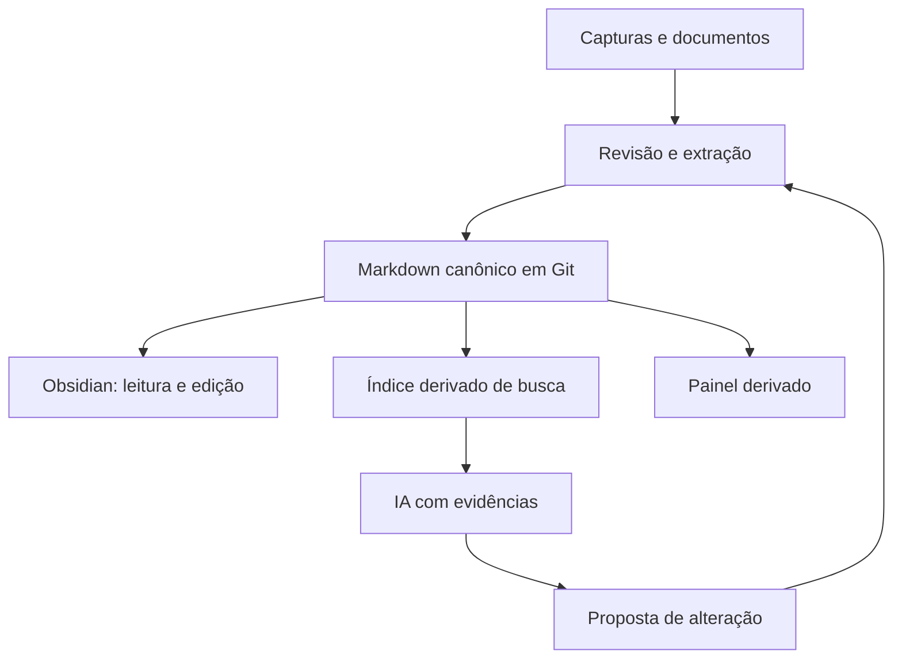

# Second brain: panorama e projetos atuais
Data de corte: **23/10/2026**. Pesquisa em português, baseada em documentação oficial, repositórios dos autores e artigos de pesquisa. Fontes identificadas por S01–S17 em [fontes.md](fontes.md).

## 1. O que significa hoje
Um segundo cérebro é um sistema externo para capturar, organizar, recuperar e usar conhecimento. Pode incluir notas, documentos, decisões e compromissos. O objetivo é transformar informação em trabalho melhor, e não maximizar o número de notas.

É útil separar três problemas:

| Camada | Pergunta | Exemplo |
|---|---|---|
| Conhecimento pessoal (PKM) | O que aprendi e como conecto as ideias? | Notas sobre BPM, ERP e métodos |
| Contexto pessoal e de projetos | O que a IA precisa saber para me ajudar agora? | Preferências, estado de um projeto, decisões vigentes |
| Memória de agentes | Como um software retém informação entre sessões? | Recuperação de preferências e histórico via API |

Uma aplicação pode atender várias camadas, mas um SDK de memória não substitui um método de trabalho. Um chatbot com documentos também não garante controle de tarefas e decisões.

## 2. Fundamentos que continuam úteis
O método CODE de Tiago Forte organiza o fluxo em capturar, organizar, destilar e expressar. PARA distingue projetos, áreas de responsabilidade, recursos e arquivos. São métodos complementares: um organiza o trabalho com informação; o outro orienta onde ela fica. [S01, S02]

Uma nota de referência pode descrever busca híbrida; uma nota de síntese deve explicar quando ela resolve um problema seu; um projeto aplica essa síntese a um resultado concreto. Links entre essas notas ajudam mais quando registram uma relação com significado, por exemplo “esta decisão depende desta evidência”.

Não é necessário reorganizar todo o vault segundo uma taxonomia nova. A pesquisa com pesquisadores de um laboratório brasileiro encontrou relação entre a forma de recuperar conhecimento e a maneira de construir e manter a base. Trata-se de estudo de caso, não de comprovação universal de uma ferramenta superior. [S15]

## 3. O que mudou em 2026
### 3.1 Gestão de contexto e IA que opera sobre arquivos
Em março de 2026, Forte apresentou sua abordagem de AI Second Brain, destacando ambientes capazes de ler arquivos e usar ferramentas. Em julho, descreveu três tipos de contexto: persistente, de projeto e perecível. São propostas do autor e também divulgação de seus produtos, não um consenso científico. [S03, S04]

**Aplicação prática:** contexto persistente guarda preferências estáveis; contexto de projeto guarda objetivos e decisões vigentes; contexto perecível guarda o detalhe temporário necessário à solicitação. Minha interpretação: separar esses elementos reduz a mistura entre fatos duráveis e estados que já mudaram.

### 3.2 Interfaces mais ricas sobre arquivos
O Obsidian documenta Bases como visualizações de arquivos e propriedades, com ordenação e filtros. A atualização pública 1.14, de 05/10/2026, acrescentou Kanban para Bases e abertura de arquivos Markdown individuais. [S05, S06]

**Limite para este repositório:** uma linha de tarefa em `tarefas.md` não é um arquivo separado. Não se deve presumir que Bases oferece, sem adaptação, um Kanban de todas essas tarefas. O painel atual continua tendo função própria.

### 3.3 Busca híbrida em vez de depender só de similaridade
QMD combina busca lexical BM25, vetores e reordenação local. [S07] Em termos simples: palavras exatas encontram nomes e siglas; busca semântica ajuda com paráfrases; reordenação seleciona os candidatos mais úteis.

**Minha recomendação:** comparar essa combinação com busca textual antes de adotá-la. Um motor mais sofisticado não assegura melhor resposta em português ou sobre um vault pequeno.

### 3.4 Memória persistente como componente
Mem0 oferece memória para usuários, sessões e agentes. Cognee constrói memória conectada com entidades, relações e trechos recuperáveis. [S12, S13] Ambos são componentes para desenvolver aplicações, exigindo integração e avaliação.

O README do Cognee noticia v1.6.1 em 24/09/2026 com conectores Google e melhorias de visualização. Também distingue a demonstração de grafo em Postgres da opção licenciada pronta para produção. Não presumir que todos os recursos compartilham a mesma disponibilidade. [S13]

### 3.5 Grafos continuam relevantes, mas projetos mudam de direção
O GraphRAG da Microsoft informa estar predominantemente em manutenção, com correções e atualizações, sem aceitar novas funcionalidades e PRs. A documentação também alerta para custo de indexação e caracteriza o código como demonstração de pesquisa. [S14]

Isso é um sinal importante de atualidade: estudar a técnica pode ser valioso, mas escolher esse repositório como base de um produto novo exige avaliar manutenção e custo.

### 3.6 Protocolos de integração
MCP padroniza a conexão de aplicações de IA com ferramentas e dados externos. Não é banco de memória, mecanismo de busca ou garantia de autorização. [S16] No seu caso, pode servir como interface futura para consultar o vault sem vincular a arquitetura a um único modelo.

## 4. Projetos e ferramentas para estudar
As funções abaixo são documentadas pelos mantenedores. A avaliação de adequação é minha; não houve instalação, benchmark ou auditoria. “Local” exige verificar também embeddings, transcrição e geração, não apenas onde a interface roda.

| Projeto | Categoria e recursos documentados | Onde agrega valor | Cuidado / adequação ao seu caso | Fonte |
|---|---|---|---|---|
| Obsidian + Bases | Editor sobre arquivos e visualizações por propriedades | Leitura e curadoria humana | Já se encaixa; o aplicativo não é open source; tarefas em linhas exigem outra visualização | S05–S06 |
| QMD | Busca local lexical, vetorial e reordenação | Recuperar notas para humanos e agentes | Primeiro candidato a piloto como índice derivado; medir PT-BR, memória e latência | S07 |
| Khoj | Assistente auto-hospedável sobre documentos e web, agentes e automações | Experiência de assistente pronta | Avaliar sincronização e proveniência para não criar estado concorrente | S08 |
| Reor | Notas locais com links automáticos, perguntas e busca semântica | Explorar PKM com modelos locais | README alerta para possível problema de frontmatter na importação; testar em cópia | S09 |
| Karakeep | Captura de links, notas e imagens, tags por IA e busca textual | Entrada de conteúdo e leitura posterior | Complementa captura; não substitui o registro canônico de tarefas | S10 |
| Open Notebook | Pesquisa por cadernos, ingestão multimídia, busca e respostas com citações | Estudo de documentos e sínteses | Usar como bancada de pesquisa, exportando sínteses aprovadas ao Git | S11 |
| Mem0 | SDK/camada de memória persistente | Desenvolver um assistente personalizado | Não é um vault pronto; memórias extraídas precisam de controle de correção | S12 |
| Cognee | Memória com grafos, vetores e recuperação de evidências | Perguntas relacionais entre projetos, pessoas e fatos | Complexidade adicional; componentes comerciais e limitações devem ser conferidos | S13 |
| Microsoft GraphRAG | Pipeline de extração e recuperação baseada em grafos | Estudo técnico de sínteses sobre corpus | Manutenção e indexação cara pesam contra adoção automática | S14 |
| Logseq | Gestão de conhecimento com abordagem de blocos; versão DB documentada | Quem prefere outliner e referências granulares | Verificar versão, exportação e compatibilidade; não assumir equivalência com arquivos Markdown | S17 |
| Second Me | Projeto de representação pessoal por IA | Explorar identidade e personalização | Linha de pesquisa distinta de controle de compromissos; benefício prático não demonstrado aqui | S18 |

**Ordem sugerida para o seu projeto:** Obsidian/Bases → QMD → Open Notebook ou Karakeep conforme a dor → Cognee/Mem0 apenas se surgir necessidade de desenvolver um serviço próprio. Khoj e Reor merecem comparação como experiências alternativas, em ambiente isolado.

## 5. Leitura crítica: o que não concluir
- Popularidade no GitHub não comprova qualidade de recuperação, segurança ou continuidade.
- Auto-hospedagem não implica processamento totalmente local: provedores externos podem receber trechos.
- Resposta com uma citação pode interpretar a fonte incorretamente; conferir se a evidência sustenta a afirmação.
- Benchmarks publicados por mantenedores têm valor dentro de seus protocolos; não foram reproduzidos nesta pesquisa e não formam ranking comparável.
- Grafo visual não equivale a raciocínio correto sobre causas, obrigações ou dependências.
- O nome “second brain” cobre desde método de notas até infraestrutura para agentes. Comparações sem separar essas categorias confundem.
- Esta é uma seleção fundamentada, não um levantamento exaustivo de todos os lançamentos até a data de corte.

## 6. Avaliação do repositório atual
Foram lidos o README, o manual CLAUDE.md, o registro de decisões e a árvore de arquivos em 23/10/2026. Não foi realizada auditoria do código do painel.

A arquitetura já declara Markdown em Git como fonte canônica, Obsidian como interface humana e painel JSON derivado. As tarefas ficam centralizadas em `tarefas.md`; decisões preservam histórico. O Monday é identificado como registro oficial da organização e o vault como camada pessoal de execução e risco.

**Minha avaliação:** essa base atende bem ao objetivo de acompanhar compromissos e preparar comunicações. Trocar tudo por um aplicativo novo pode perder justamente as regras operacionais que fazem o sistema funcionar.

Evoluções propostas, ainda não aprovadas como decisões arquiteturais:
1. Criar identificadores estáveis para tarefas e decisões, caso renomear ou mover conteúdo comece a quebrar referências.
2. Acrescentar data de verificação, origem e estado de confirmação às sínteses de conhecimento.
3. Manter documentos originais separados de sínteses produzidas por IA.
4. Construir contexto de projeto sob demanda, citando arquivos e o commit consultado.
5. Introduzir busca híbrida somente como índice reconstruível.
6. Medir recuperação e qualidade dos informes antes de incorporar grafos ou memória externa.

Não registrei essas propostas como compromissos do Bruno e não alterei a arquitetura operacional.

## 7. Arquitetura de referência proposta

O agente recupera evidências, produz uma resposta ou propõe um diff. Alterações aceitas voltam ao Markdown. O índice pode ser apagado e reconstruído; ele não passa a ser o registro original. Uma resposta deve distinguir fato documentado, inferência e informação que falta.

Para perguntas de prazo e estado atual, usar campos estruturados e a versão vigente. Similaridade semântica sozinha pode trazer uma decisão antiga que foi revogada.

## 8. Experimentos recomendados
| Experimento proposto | Procedimento | Critério inicial de sucesso |
|---|---|---|
| Recuperação | Elaborar 20 perguntas reais e comparar busca textual com QMD | Fonte correta nos cinco primeiros resultados em pelo menos 18 perguntas |
| Fidelidade | Responder perguntas com e sem evidência disponível | Nenhum prazo, compromisso ou conclusão inventado; abstenção quando faltar evidência |
| Atualização | Alterar uma decisão de teste e reconstruir o índice | A resposta apresenta o estado novo e preserva o histórico |
| Proveniência | Gerar cinco informes de projeto | Cada afirmação verificável aponta ao arquivo correspondente |
| Portabilidade | Reconstruir busca e painel em outra cópia | Nenhuma perda do registro canônico |
| Uso diário | Registrar tempo e esforço por duas semanas | Menor esforço de captura e recuperação, sem crescimento de pendências esquecidas |

Esses números são metas propostas para um piloto, não resultados obtidos.

## 9. Conclusão aplicada
O avanço mais útil para este segundo cérebro é tornar o contexto recuperável, verificável e atualizado. Começaria com qualidade das fontes, revisão de estados e busca híbrida reconstruível. Só acrescentaria um grafo ou uma camada de memória se os testes mostrarem perguntas importantes que a solução simples não resolve.

Veja [roteiro de aprendizagem](roteiro-aprendizagem.md) e [fontes comentadas](fontes.md).
